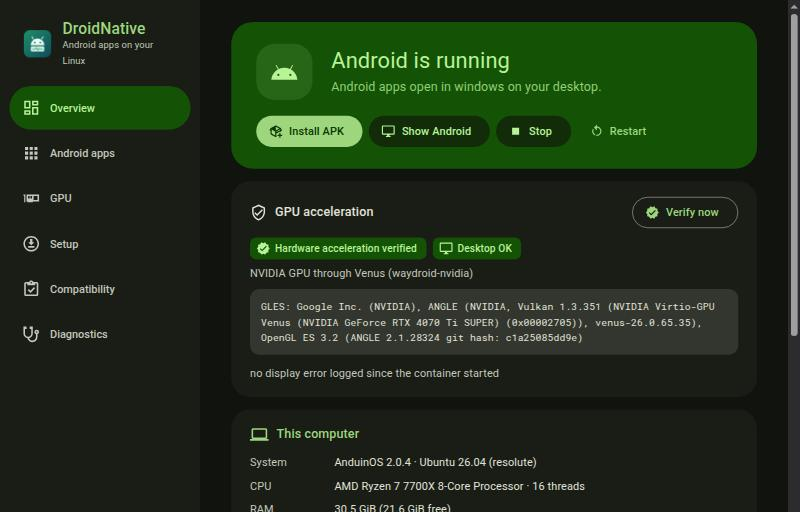
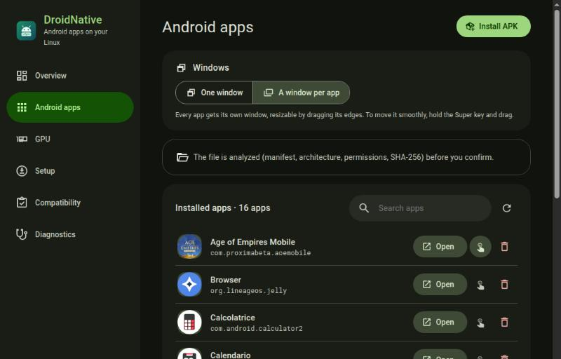

# DroidNative

**Real Android apps on Debian/Ubuntu Linux, in a container instead of an emulator, with GPU
acceleration verified against the renderer Android actually uses — never just assumed.**



DroidNative is a desktop application (Tauri 2 + React, Rust backend) that:

- analyzes the computer (distribution, kernel, binder, cgroups, GPU, drivers, session,
  firewall) and produces a compatibility report;
- installs and configures [Waydroid](https://github.com/waydroid/waydroid) through a guided
  setup, asking for the administrator password only for operations from a closed list;
- picks and activates the right GPU backend, NVIDIA GPUs included through
  [waydroid-nvidia](https://github.com/Shiro836/waydroid-nvidia);
- **verifies** acceleration by reading SurfaceFlinger's renderer and checks that Android's
  windows really reach the desktop;
- installs, launches and removes APKs, analyzing them first (manifest, ABIs, permissions,
  SHA-256) and confirming an install only once Android has completed it;
- switches to the Android image with **Google Play** (Play Store and Google Play Services)
  keeping apps and data, and guides the device registration with Google;
- installs **ARM translation** (libndk or libhoudini), so apps and games shipped only for ARM
  processors run too;
- turns mouse clicks into **touch** for the games that ignore the mouse, and lets each app
  get its own desktop window where the graphics stack supports it (see
  [Windows and mouse](#windows-and-mouse)).

Material 3 interface (system light and dark theme). Language: Italian when the session is in
Italian (`LANGUAGE`, `LC_ALL`, `LC_MESSAGES`, `LANG`), English in every other case — for the
app, the CLI and the privileged helper's messages alike.

## Install

Requirements: x86_64, Ubuntu 24.04+ or Debian 12+ (and derivatives: Mint, Pop!_OS, Zorin,
Kali, KDE Neon…), a Wayland session, a kernel with binder (distribution kernels include it).

1. Download `droidnative_<version>_amd64.deb` from the
   [Releases](https://github.com/Foglio24/droidnative/releases/latest).
2. (Optional) verify the package:

   ```bash
   sha256sum -c SHA256SUMS --ignore-missing
   ```

   ```bash
   gh attestation verify droidnative_0.4.1_amd64.deb --repo Foglio24/droidnative
   ```

3. Install it, from a terminal in the folder where you downloaded the file:

   ```bash
   sudo apt install ./droidnative_0.4.1_amd64.deb
   ```

4. Open **DroidNative** from the applications menu and follow **Setup**.

The package installs `/usr/bin/droidnative-app` (interface), `/usr/bin/droidnative` (CLI and
privileged helper), the polkit action `io.droidnative.priv` and
`droidnative-render-node.service` (see [GPU backends](#gpu-backends)). To remove it:
`sudo apt remove droidnative` (Waydroid, images and Android data stay).

### Installing an Android app

Open **Android apps**, press **Start Android** and then **Install APK**: DroidNative analyzes
the file, shows its name, version, permissions and CPU compatibility and, once you confirm,
installs it and waits for Android to finish. The app appears in the list and in the desktop's
applications menu. From a terminal: `droidnative app install file.apk`.

### Windows and mouse

- **Windows** (on the Android apps page): *One window* keeps Android in a single desktop
  window with the apps inside it; *A window per app* gives every app its own desktop window
  (Android's PC mode with freeform windows). Changing the mode restarts Android. From a
  terminal: `droidnative windows single|multi`.
  - With **waydroid-nvidia on GNOME** (or any compositor other than KDE's KWin, the only one
    upstream tests), *A window per app* is not available: moving a window leaves trails of it
    over the whole screen, and Android's keyboard pops up as a separate window that takes the
    focus. DroidNative disables the option there.
  - On GNOME the Android window has **no title bar or borders**: GNOME draws none for Wayland
    apps that do not draw their own, and Waydroid's display component does not draw one. The
    window stays maximized. Running it inside gamescope gives it a title bar, but Android keeps
    a fixed resolution scaled into the window (black bands), so DroidNative does not do it.
- **Mouse as touch** (the hand icon next to each app): many games, Unity ones in particular,
  react only to touch and ignore mouse clicks. With this on, Android delivers the app's clicks
  and drags as touches. It applies the next time the app opens; Android limits the list to 91
  characters. From a terminal: `droidnative app touch <package> on|off`.

### Google Play and ARM apps

Two optional steps in **Setup**:

- **Google services (Play Store)** downloads Waydroid's official GAPPS image (LineageOS with
  Play Store and Google Play Services) and activates it; apps and data stay and, with
  waydroid-nvidia, the GPU mode is re-activated by itself. Google blocks the Play Store on
  uncertified devices: open the Play Store once, press **Show ID** in the “Register the
  device with Google” card, register the ID at
  [google.com/android/uncertified](https://www.google.com/android/uncertified) with your
  account and restart Android after a few minutes. Back to the image without Google:
  `droidnative system-image vanilla`.
- **ARM translation** installs an ARM→x86 translator into Waydroid's system overlay: Android
  then declares the `arm64-v8a` and `armeabi-v7a` ABIs and ARM-only APKs are marked as
  “translated”. Two translators are available, and some apps run with only one of them:
  **libndk** (Google, the default on AMD CPUs) and **libhoudini** (Intel, the default on Intel
  CPUs). When an ARM app closes right after starting, switch with the **Use libhoudini** /
  **Use libndk** button on the same step, or `droidnative arm-translation install --translator
  libhoudini`. Age of Empires Mobile, for instance, aborts inside libndk and runs with
  libhoudini.

  Both are proprietary binaries that DroidNative does not ship: it downloads them, only when
  you choose the step, from third-party archives
  ([libndk](https://github.com/supremegamers/vendor_google_proprietary_ndk_translation-prebuilt),
  [libhoudini](https://github.com/supremegamers/vendor_intel_proprietary_houdini)) pinned to a
  commit and checked with SHA-256 — the same archives casualsnek/waydroid_script uses. This
  libhoudini build states at startup that it is licensed for Google Play Games on Windows
  under a commercial agreement; using it elsewhere is your call. At every Android boot the
  translator registers four `binfmt_misc` handlers in the host kernel (`arm_exe`, `arm_dyn`,
  `arm64_exe`, `arm64_dyn`) which, while installed, take precedence over `qemu-user-static`'s
  for ARM executables started on the host. `droidnative arm-translation remove` removes files,
  properties and handlers.

Apps that require strong Play Integrity (many banking apps, some apps with DRM or anti-cheat)
may refuse to work even on a registered device.

## GPU backends



| Backend | Stack | When |
|---|---|---|
| Mesa Native | Mesa (RadeonSI/RADV, Iris/ANV) on the GPU's render node | AMD/Intel driving the display |
| NVIDIA Accelerated | waydroid-nvidia, `venus` mode (Vulkan forwarded to the host driver) | RTX 20+ with open driver ≥ 595.71, `nvidia-drm.modeset=1`, display on the NVIDIA GPU |
| NVIDIA Experimental | waydroid-nvidia, `nvidia-prolapse` mode (NVK + NVIDIA backend inside Android) | as above; experimental |
| Software Fallback | SwiftShader | always; never reported as accelerated |

Installing waydroid-nvidia uses a release **pinned in the code** (hash of `SHA256SUMS` and
source commit), verifies every file before running the official installer and replaces the
distribution's `waydroid` package with the patched build; Android images and data stay.
Before every container start, `droidnative-render-node.service` checks again which
`/dev/dri/renderD*` is the NVIDIA GPU: on PCs with two GPUs the number can change at every
boot. On desktops other than KDE, DroidNative also turns off waydroid-nvidia's direct
subsurface (`persist.waydroid.use_subsurface`), which `waydroid-nvidia-setup` turns back on at
every run: SurfaceFlinger then composes on the NVIDIA GPU and the desktop gets one image per
window, acceleration included. Details in [docs/ARCHITECTURE.md](docs/ARCHITECTURE.md).

## Command line

```bash
droidnative doctor
```

```bash
droidnative gpu
```

```bash
droidnative setup
```

```bash
droidnative verify-gpu
```

Other commands: `setup --run <step>`, `status`, `session start|stop|restart`, `ui`,
`apk <file>`, `app list|install|launch|remove|touch`, `windows single|multi`, `gpu-select`,
`nvidia-mode`, `system-image gapps|vanilla`, `arm-translation install|remove`, `google-id`,
`logs`. Without a polkit agent (SSH): `DROIDNATIVE_ESCALATOR=sudo droidnative …`.

## Status

Verified on an AMD Ryzen 7 7700X + RTX 4070 Ti SUPER (open driver 615) + AMD Raphael iGPU,
AnduinOS 2.0.4 (Ubuntu 26.04), GNOME/Mutter on Wayland:

| Feature | Result |
|---|---|
| Compatibility report, backend assessment | ✅ |
| Waydroid install (official repository, key fingerprint checked), images, container | ✅ |
| Android start/stop, waiting for boot | ✅ (4–10 s) |
| APKs: analysis, install confirmed by Android's commit, launch, removal | ✅ |
| NVIDIA Accelerated (venus) | ✅ `ANGLE (NVIDIA, Vulkan 1.3.351 (NVIDIA Virtio-GPU Venus (RTX 4070 Ti SUPER)))` |
| NVIDIA Experimental (nvidia-prolapse) | ✅ upstream gate 22/22, `NVK NV193` |
| Container start after a reboot that swapped the GPUs' render nodes | ✅ repaired automatically before the start |
| Mesa on the iGPU with the display on the NVIDIA GPU | ❌ detected and reported: the compositor rejects the buffers |
| Container network with the UFW firewall on | guided step ready; the user applies the rules |
| GAPPS image: Play Store and Google Play Services, NVIDIA acceleration kept | ✅ GMS 23.10.15, device ID read |
| ARM translation: ARM-only VLC (`armeabi-v7a` and `arm64-v8a`) with libndk | ✅ native libraries loaded through `libndk_translation.so`; removal and reinstall verified |
| ARM translation: Age of Empires Mobile (ARM64 only, Tencent ACE) | ❌ with libndk (abort in the translator), ✅ with libhoudini |
| waydroid-nvidia's direct subsurface on GNOME/Mutter | ❌ composer abort and trails (upstream #21): DroidNative turns it off after every waydroid-nvidia setup |
| A window per app with waydroid-nvidia on GNOME/Mutter | ❌ trails over the whole desktop, keyboard as a separate window: disabled |
| Resizing the single Android window on GNOME | ❌ no title bar or borders from GNOME; with gamescope a bar but a scaled, fixed-resolution Android |
| Clipboard, notifications, file sharing, nested X11 | not implemented yet |

Real problems found and handled: [docs/RESEARCH.md](docs/RESEARCH.md#end-to-end-checks-on-the-development-pc).
Full report of the development PC: [docs/COMPATIBILITY-dev-pc.md](docs/COMPATIBILITY-dev-pc.md).

## Building from source

Dependencies (Debian/Ubuntu): `build-essential pkg-config libwebkit2gtk-4.1-dev libgtk-3-dev
libayatana-appindicator3-dev librsvg2-dev libssl-dev libsoup-3.0-dev`, stable Rust, Node.js 22.

```bash
cargo test --workspace
```

```bash
cargo build --release -p droidnative-cli
```

```bash
cd app && npm ci && npx tauri build
```

Development: `cd app && npx tauri dev` (with `DROIDNATIVE_TRACE=1` every IPC command is
logged). CI builds the package in a Debian 12 container and, on `v*` tags, publishes the
Release with checksums and a build provenance attestation.

| Path | Contents |
|---|---|
| `crates/droidnative-core` | detection, GPU backends, Waydroid runtime, APKs, privileged operations, waydroid-nvidia, Google image and ARM translation |
| `crates/droidnative-cli` | the `droidnative` binary |
| `app/` | Tauri 2 + React/TypeScript application |
| `packaging/` | polkit policy, systemd unit, maintainer scripts, Debian copyright |
| `docs/` | research, architecture, reports |

## License

GPL-3.0-or-later — see [LICENSE](LICENSE). DroidNative includes no code from Waydroid or
waydroid-nvidia: it installs them from their official sources, each under its own license.
Nor does it include Google's apps, libndk or libhoudini: the GAPPS image comes from Waydroid's
official OTA channel and the translators from the archives listed above, only when you choose
the optional steps; they remain subject to their owners' terms.
