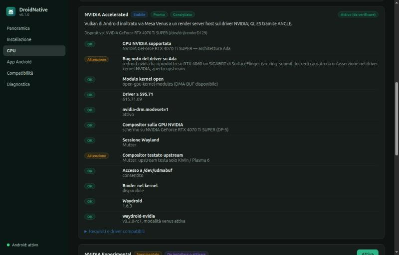

# DroidNative

**App Android reali su Linux Debian/Ubuntu, in un container invece che in un emulatore,
con accelerazione GPU verificata sul renderer reale.**

*Real Android apps on Debian/Ubuntu Linux in a container (Waydroid), with GPU acceleration
that is verified against the renderer Android actually uses — never just assumed.*


DroidNative è un'applicazione desktop (Tauri 2 + React, backend Rust) che:

- analizza il computer (distribuzione, kernel, binder, cgroups, GPU, driver, sessione, firewall)
  e produce un report di compatibilità;
- installa e configura [Waydroid](https://github.com/waydroid/waydroid) con un percorso guidato,
  chiedendo la password di amministratore solo per operazioni di un elenco chiuso;
- sceglie e attiva il backend GPU adatto, comprese le GPU NVIDIA tramite
  [waydroid-nvidia](https://github.com/Shiro836/waydroid-nvidia);
- **verifica** l'accelerazione leggendo il renderer di SurfaceFlinger e controlla che le
  finestre Android arrivino davvero sul desktop;
- installa, avvia e rimuove gli APK, analizzandoli prima (manifest, ABI, permessi, SHA-256)
  e confermando l'installazione solo quando Android l'ha completata.

## Installazione

Requisiti: x86_64, Ubuntu 24.04+ o Debian 12+ (e derivate: Mint, Pop!_OS, Zorin, Kali,
KDE Neon…), sessione Wayland, kernel con binder (i kernel delle distribuzioni lo includono).

1. Scarica `droidnative_<versione>_amd64.deb` dalle
   [Release](https://github.com/Foglio24/droidnative/releases/latest).
2. (Facoltativo) verifica il pacchetto:

   ```bash
   sha256sum -c SHA256SUMS --ignore-missing
   ```

   ```bash
   gh attestation verify droidnative_0.1.0_amd64.deb --repo Foglio24/droidnative
   ```

3. Installa:

   ```bash
   sudo apt install ./droidnative_0.1.0_amd64.deb
   ```

4. Apri **DroidNative** dal menu delle applicazioni e segui **Installazione**.

Il pacchetto installa `/usr/bin/droidnative-app` (interfaccia), `/usr/bin/droidnative`
(CLI e helper privilegiato) e l'azione polkit `io.droidnative.priv`. Per rimuoverlo:
`sudo apt remove droidnative` (Waydroid, immagini e dati Android restano).

## Backend GPU



| Backend | Stack | Quando |
|---|---|---|
| Mesa Native | Mesa (RadeonSI/RADV, Iris/ANV) sul nodo render della GPU | AMD/Intel che pilota il display |
| NVIDIA Accelerated | waydroid-nvidia, modalità `venus` (Vulkan inoltrato al driver host) | RTX 20+ con driver open ≥ 595.71, `nvidia-drm.modeset=1`, display sulla NVIDIA |
| NVIDIA Experimental | waydroid-nvidia, modalità `nvidia-prolapse` (NVK + backend NVIDIA in Android) | come sopra; sperimentale |
| Software Fallback | SwiftShader | sempre; mai dichiarato accelerato |

L'installazione di waydroid-nvidia usa un rilascio **fissato nel codice** (hash di
`SHA256SUMS` e commit del sorgente), verifica ogni file prima di eseguire l'installer
ufficiale e sostituisce il pacchetto `waydroid` della distribuzione con la build patchata;
immagini e dati Android restano. Dettagli in [docs/ARCHITECTURE.md](docs/ARCHITECTURE.md).

## Uso da terminale

```bash
droidnative doctor
```

```bash
droidnative gpu
```

```bash
droidnative setup
```

```bash
droidnative verify-gpu
```

Altri comandi: `setup --run <passo>`, `status`, `session start|stop|restart`, `ui`,
`apk <file>`, `app list|install|launch|remove`, `gpu-select`, `nvidia-mode`, `logs`.
Senza agente polkit (SSH): `DROIDNATIVE_ESCALATOR=sudo droidnative …`.

## Stato

Verificato su AMD Ryzen 7 7700X + RTX 4070 Ti SUPER (driver 615 open) + iGPU AMD Raphael,
AnduinOS 2.0.4 (Ubuntu 26.04), GNOME/Mutter su Wayland:

| Funzione | Esito |
|---|---|
| Report di compatibilità, valutazione dei backend | ✅ |
| Installazione Waydroid (repo ufficiale, impronta della chiave verificata), immagini, container | ✅ |
| Avvio/arresto di Android, attesa del boot | ✅ (4–10 s) |
| APK: analisi, installazione confermata dal commit di Android, avvio, rimozione | ✅ |
| NVIDIA Accelerated (venus) | ✅ `ANGLE (NVIDIA, Vulkan 1.3.351 (NVIDIA Virtio-GPU Venus (RTX 4070 Ti SUPER)))` |
| NVIDIA Experimental (nvidia-prolapse) | ✅ gate upstream 22/22, `NVK NV193` |
| Mesa sull'iGPU con display sulla NVIDIA | ❌ rilevato e segnalato: il compositor rifiuta i buffer |
| Rete del container con firewall UFW attivo | passo guidato pronto; le regole le applica l'utente |
| Clipboard, notifiche, condivisione file, X11 annidato, ARM64 | da implementare |

Problemi reali trovati e gestiti: [docs/RESEARCH.md](docs/RESEARCH.md#verifiche-end-to-end-su-questo-pc-2026-10-19).
Report completo del PC di sviluppo: [docs/COMPATIBILITY-dev-pc.md](docs/COMPATIBILITY-dev-pc.md).

## Compilare dai sorgenti

Dipendenze (Debian/Ubuntu): `build-essential pkg-config libwebkit2gtk-4.1-dev libgtk-3-dev
libayatana-appindicator3-dev librsvg2-dev libssl-dev libsoup-3.0-dev`, Rust stabile, Node.js 22.

```bash
cargo test --workspace
```

```bash
cargo build --release -p droidnative-cli
```

```bash
cd app && npm ci && npx tauri build
```

Sviluppo: `cd app && npx tauri dev` (con `DROIDNATIVE_TRACE=1` ogni comando IPC viene
registrato). La CI compila il pacchetto in un container Debian 12 e, sui tag `v*`,
pubblica la Release con checksum e attestazione di provenienza.

| Percorso | Contenuto |
|---|---|
| `crates/droidnative-core` | rilevamento, backend GPU, runtime Waydroid, APK, operazioni privilegiate, waydroid-nvidia |
| `crates/droidnative-cli` | binario `droidnative` |
| `app/` | applicazione Tauri 2 + React/TypeScript |
| `packaging/` | policy polkit, copyright Debian |
| `docs/` | ricerca, architettura, report |

## Licenza

GPL-3.0-or-later — vedi [LICENSE](LICENSE). DroidNative non include codice di Waydroid né di
waydroid-nvidia: li installa dalle loro fonti ufficiali, ciascuno con la propria licenza.
