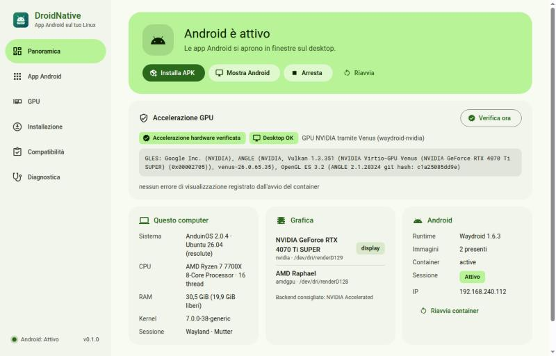
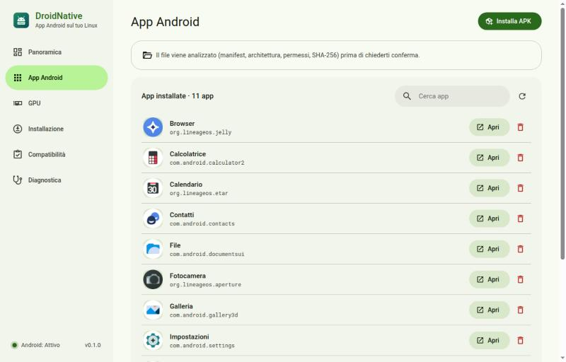

# DroidNative

**App Android reali su Linux Debian/Ubuntu, in un container invece che in un emulatore,
con accelerazione GPU verificata sul renderer reale.**

*Real Android apps on Debian/Ubuntu Linux in a container (Waydroid), with GPU acceleration
that is verified against the renderer Android actually uses — never just assumed.*



DroidNative è un'applicazione desktop (Tauri 2 + React, backend Rust) che:

- analizza il computer (distribuzione, kernel, binder, cgroups, GPU, driver, sessione, firewall)
  e produce un report di compatibilità;
- installa e configura [Waydroid](https://github.com/waydroid/waydroid) con un percorso guidato,
  chiedendo la password di amministratore solo per operazioni di un elenco chiuso;
- sceglie e attiva il backend GPU adatto, comprese le GPU NVIDIA tramite
  [waydroid-nvidia](https://github.com/Shiro836/waydroid-nvidia);
- **verifica** l'accelerazione leggendo il renderer di SurfaceFlinger e controlla che le
  finestre Android arrivino davvero sul desktop;
- installa, avvia e rimuove gli APK, analizzandoli prima (manifest, ABI, permessi, SHA-256)
  e confermando l'installazione solo quando Android l'ha completata;
- passa all'immagine Android con **Google Play** (Play Store e Google Play Services)
  conservando app e dati, e guida la registrazione del dispositivo con Google;
- installa la **traduzione ARM** (libndk), così funzionano anche le app e i giochi
  distribuiti solo per processori ARM.

Interfaccia in stile Material 3 (tema chiaro e scuro di sistema). Lingua: italiano se la
sessione è in italiano (`LANGUAGE`, `LC_ALL`, `LC_MESSAGES`, `LANG`), inglese in tutti gli
altri casi — vale per l'app, la CLI e i messaggi dell'helper privilegiato.

## Installazione

Requisiti: x86_64, Ubuntu 24.04+ o Debian 12+ (e derivate: Mint, Pop!_OS, Zorin, Kali,
KDE Neon…), sessione Wayland, kernel con binder (i kernel delle distribuzioni lo includono).

1. Scarica `droidnative_<versione>_amd64.deb` dalle
   [Release](https://github.com/Foglio24/droidnative/releases/latest).
2. (Facoltativo) verifica il pacchetto:

   ```bash
   sha256sum -c SHA256SUMS --ignore-missing
   ```

   ```bash
   gh attestation verify droidnative_0.3.0_amd64.deb --repo Foglio24/droidnative
   ```

3. Installa:

   ```bash
   sudo apt install ./droidnative_0.3.0_amd64.deb
   ```

   (il comando va lanciato nella cartella in cui hai scaricato il file)
4. Apri **DroidNative** dal menu delle applicazioni e segui **Installazione**.

### Installare un'app Android

Apri **App Android**, premi **Avvia Android** e poi **Installa APK**: DroidNative analizza il
file, ti mostra nome, versione, permessi e compatibilità con la CPU e, dopo la conferma, lo
installa e attende che Android completi l'installazione. L'app compare nell'elenco e nel
menu delle applicazioni del desktop. Da terminale: `droidnative app install file.apk`.

### Google Play e app ARM

Due passi facoltativi in **Installazione**:

- **Servizi Google (Play Store)** scarica l'immagine GAPPS ufficiale di Waydroid
  (LineageOS con Play Store e Google Play Services) e la attiva; app e dati restano e,
  con waydroid-nvidia, la modalità GPU viene riattivata da sola. Google blocca il Play
  Store sui dispositivi non certificati: apri il Play Store una volta, premi **Mostra ID**
  nella scheda «Registra il dispositivo con Google», registra l'ID su
  [google.com/android/uncertified](https://www.google.com/android/uncertified) con il tuo
  account e dopo qualche minuto riavvia Android. Per tornare all'immagine senza Google:
  `droidnative system-image vanilla`.
- **Traduzione ARM (libndk)** installa il traduttore ARM→x86 di Google nell'overlay di
  sistema di Waydroid: Android dichiara le ABI `arm64-v8a` e `armeabi-v7a`, e gli APK con
  solo codice ARM vengono indicati come «tradotti». libndk è un binario proprietario di
  Google, scaricato da un archivio di terze parti
  ([supremegamers](https://github.com/supremegamers/vendor_google_proprietary_ndk_translation-prebuilt))
  fissato a un commit e verificato con SHA-256. All'avvio di Android registra nel kernel
  dell'host quattro gestori `binfmt_misc` (`arm_exe`, `arm_dyn`, `arm64_exe`, `arm64_dyn`)
  che, finché è installato, hanno la precedenza su quelli di `qemu-user-static` per gli
  eseguibili ARM lanciati sull'host. `droidnative arm-translation remove` rimuove file,
  proprietà e gestori.

Le app che richiedono Play Integrity forte (molte app bancarie, alcune app con DRM o
anti-cheat) possono rifiutarsi di funzionare anche con il dispositivo registrato.

Il pacchetto installa `/usr/bin/droidnative-app` (interfaccia), `/usr/bin/droidnative`
(CLI e helper privilegiato) e l'azione polkit `io.droidnative.priv`. Per rimuoverlo:
`sudo apt remove droidnative` (Waydroid, immagini e dati Android restano).

## Backend GPU



| Backend | Stack | Quando |
|---|---|---|
| Mesa Native | Mesa (RadeonSI/RADV, Iris/ANV) sul nodo render della GPU | AMD/Intel che pilota il display |
| NVIDIA Accelerated | waydroid-nvidia, modalità `venus` (Vulkan inoltrato al driver host) | RTX 20+ con driver open ≥ 595.71, `nvidia-drm.modeset=1`, display sulla NVIDIA |
| NVIDIA Experimental | waydroid-nvidia, modalità `nvidia-prolapse` (NVK + backend NVIDIA in Android) | come sopra; sperimentale |
| Software Fallback | SwiftShader | sempre; mai dichiarato accelerato |

L'installazione di waydroid-nvidia usa un rilascio **fissato nel codice** (hash di
`SHA256SUMS` e commit del sorgente), verifica ogni file prima di eseguire l'installer
ufficiale e sostituisce il pacchetto `waydroid` della distribuzione con la build patchata;
immagini e dati Android restano. Dettagli in [docs/ARCHITECTURE.md](docs/ARCHITECTURE.md).

## Uso da terminale

```bash
droidnative doctor
```

```bash
droidnative gpu
```

```bash
droidnative setup
```

```bash
droidnative verify-gpu
```

Altri comandi: `setup --run <passo>`, `status`, `session start|stop|restart`, `ui`,
`apk <file>`, `app list|install|launch|remove`, `gpu-select`, `nvidia-mode`,
`system-image gapps|vanilla`, `arm-translation install|remove`, `google-id`, `logs`.
Senza agente polkit (SSH): `DROIDNATIVE_ESCALATOR=sudo droidnative …`.

## Stato

Verificato su AMD Ryzen 7 7700X + RTX 4070 Ti SUPER (driver 615 open) + iGPU AMD Raphael,
AnduinOS 2.0.4 (Ubuntu 26.04), GNOME/Mutter su Wayland:

| Funzione | Esito |
|---|---|
| Report di compatibilità, valutazione dei backend | ✅ |
| Installazione Waydroid (repo ufficiale, impronta della chiave verificata), immagini, container | ✅ |
| Avvio/arresto di Android, attesa del boot | ✅ (4–10 s) |
| APK: analisi, installazione confermata dal commit di Android, avvio, rimozione | ✅ |
| NVIDIA Accelerated (venus) | ✅ `ANGLE (NVIDIA, Vulkan 1.3.351 (NVIDIA Virtio-GPU Venus (RTX 4070 Ti SUPER)))` |
| NVIDIA Experimental (nvidia-prolapse) | ✅ gate upstream 22/22, `NVK NV193` |
| Mesa sull'iGPU con display sulla NVIDIA | ❌ rilevato e segnalato: il compositor rifiuta i buffer |
| Rete del container con firewall UFW attivo | passo guidato pronto; le regole le applica l'utente |
| Immagine GAPPS: Play Store e Google Play Services, accelerazione NVIDIA conservata | ✅ GMS 23.10.15, ID dispositivo letto |
| Traduzione ARM libndk: VLC solo ARM (`armeabi-v7a` e `arm64-v8a`) installato e avviato | ✅ librerie native caricate tramite `libndk_translation.so`; rimozione e reinstallazione verificate |
| Clipboard, notifiche, condivisione file, X11 annidato | da implementare |

Problemi reali trovati e gestiti: [docs/RESEARCH.md](docs/RESEARCH.md#verifiche-end-to-end-su-questo-pc-2026-10-19).
Report completo del PC di sviluppo: [docs/COMPATIBILITY-dev-pc.md](docs/COMPATIBILITY-dev-pc.md).

## Compilare dai sorgenti

Dipendenze (Debian/Ubuntu): `build-essential pkg-config libwebkit2gtk-4.1-dev libgtk-3-dev
libayatana-appindicator3-dev librsvg2-dev libssl-dev libsoup-3.0-dev`, Rust stabile, Node.js 22.

```bash
cargo test --workspace
```

```bash
cargo build --release -p droidnative-cli
```

```bash
cd app && npm ci && npx tauri build
```

Sviluppo: `cd app && npx tauri dev` (con `DROIDNATIVE_TRACE=1` ogni comando IPC viene
registrato). La CI compila il pacchetto in un container Debian 12 e, sui tag `v*`,
pubblica la Release con checksum e attestazione di provenienza.

| Percorso | Contenuto |
|---|---|
| `crates/droidnative-core` | rilevamento, backend GPU, runtime Waydroid, APK, operazioni privilegiate, waydroid-nvidia |
| `crates/droidnative-cli` | binario `droidnative` |
| `app/` | applicazione Tauri 2 + React/TypeScript |
| `packaging/` | policy polkit, copyright Debian |
| `docs/` | ricerca, architettura, report |

## Licenza

GPL-3.0-or-later — vedi [LICENSE](LICENSE). DroidNative non include codice di Waydroid né di
waydroid-nvidia: li installa dalle loro fonti ufficiali, ciascuno con la propria licenza.
Non include nemmeno le app Google né libndk: l'immagine GAPPS arriva dal canale OTA
ufficiale di Waydroid e libndk dall'archivio indicato sopra, solo quando scegli i passi
facoltativi; restano soggetti alle condizioni di Google.
